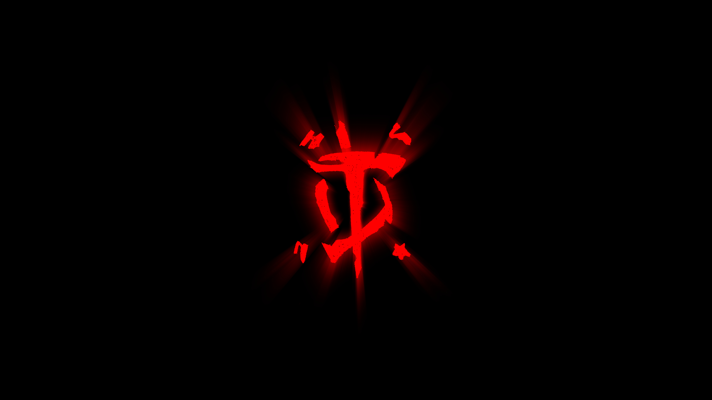
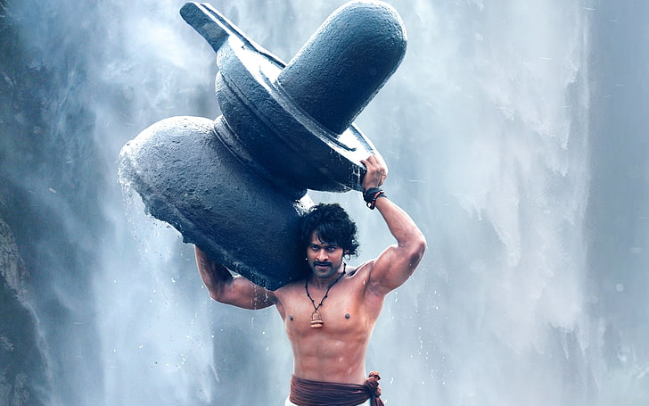
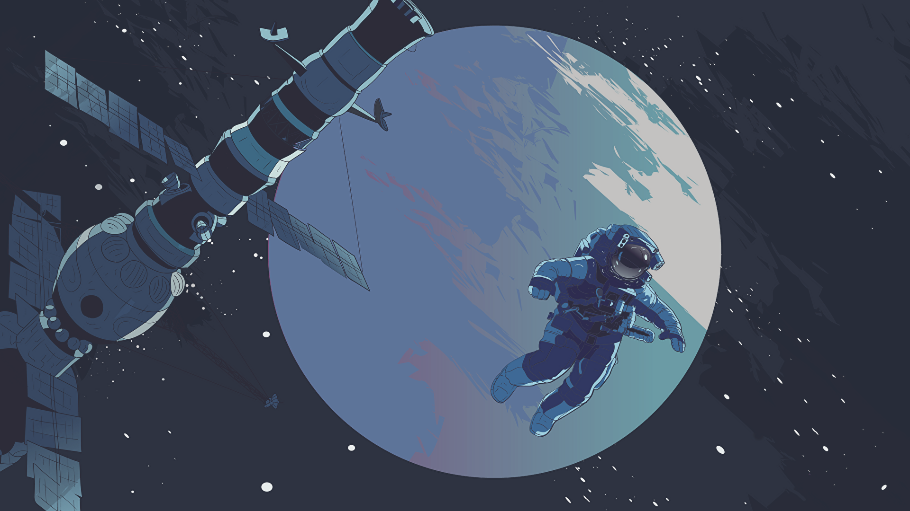
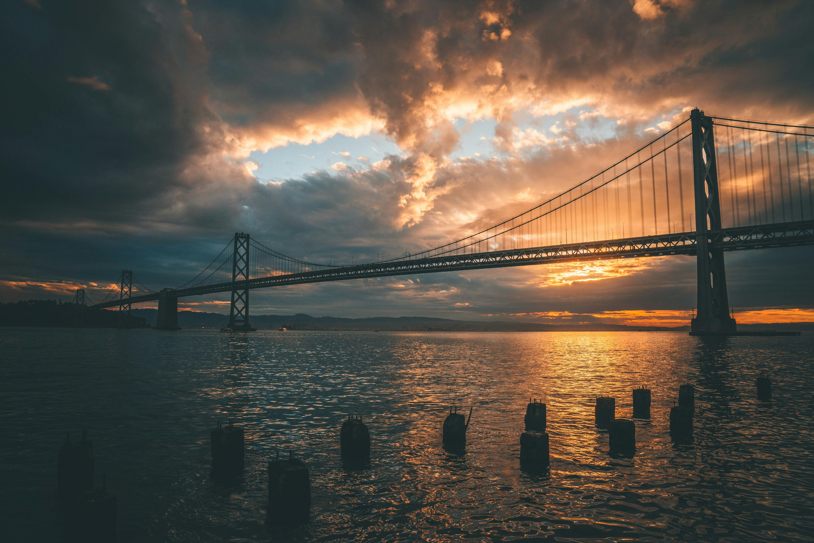

# Wallpapers

A personal archive of wallpapers I've picked up, kept around, and occasionally become irrationally attached to.

No particular theme. Just things I thought looked good enough to keep.

## Collection

### Animated

Live and animated backgrounds.

### Anime

Characters, scenes, and art from anime I like.

### Dark

Mostly black. Easy on the eyes, the OLED pixels, and my increasingly questionable taste in wallpapers.

### Favourites

The ones I like.

### Games

A collection of worlds I apparently need to have on my desktop even when I'm not playing them.

### Memes

Because apparently a desktop background can also be a shitpost.

### Minimal

Clean, quiet, and preferably not trying to cover half the screen in visual noise.

### Scenery

Places I can't currently afford to visit, or places that simply look better than wherever my desktop happens to be.

### Uncategorized

Things I haven't figured out where to put yet.

## About the collection

Most of these wallpapers were found around the internet and collected for personal use and archival purposes.

I don't claim ownership of the artwork in this repository. Copyright remains with the original creators and rights holders.

Where I know the original source or creator, I've recorded it in [`SOURCES.md`](SOURCES.md).

If you're the creator or copyright holder of something here and want it removed, open an issue or get in touch.
